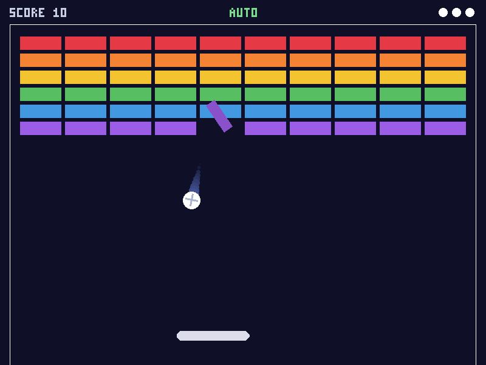
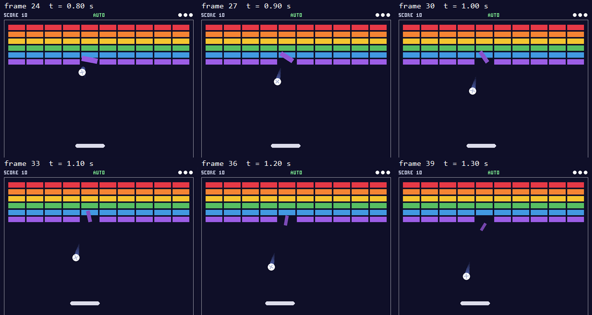

# Pixel Breakout — Room 13

A Breakout game built from the ground up: every shape is drawn by **our own
rasterization algorithms** into a CPU framebuffer, then shown in real time with
**OpenGL 3.3**.



## Build & run (Linux / WSL)

```bash
sudo apt install build-essential libglfw3-dev libgl-dev
make
./pixel_breakout
```

| Key | Action |
| --- | --- |
| ← / → or mouse | Move paddle |
| Space | Launch ball / restart after win or game over |
| P | Pause |
| R | Restart |
| A | Toggle autoplay (demo mode) |
| S or F12 | Save a screenshot (`screenshot_NN.bmp`) |
| Esc | Quit |

`make frames` runs the game headless on autoplay and writes 150 frames
(5 s at 30 fps) to `frames/`, which can be stitched into a GIF/video.

## Project phases

| Phase | What | Where |
| --- | --- | --- |
| 1 | Framebuffer, PPM/BMP output | [framebuffer.cpp](src/framebuffer.cpp) |
| 2 | Bresenham lines, midpoint circles, scanline polygon fill | [line.cpp](src/line.cpp), [circle.cpp](src/circle.cpp), [polygon.cpp](src/polygon.cpp) |
| **3** | **Transforms, OpenGL, animation & interaction** | see below |

## Phase 3 — Transform and animate

### Transforms ([transform.cpp](src/transform.cpp))
2D transforms as **3×3 homogeneous matrices** (`Mat3`): `translate`, `rotate`,
`scale`, matrix multiply, and `aboutPoint` (rotate/scale around a pivot:
`T(p)·M·T(−p)`). Shapes are defined once in local coordinates centred on (0, 0),
pushed through a matrix, then filled with our scanline polygon algorithm.

| Effect | Transform | Code |
| --- | --- | --- |
| Ball and paddle movement | Translation (position += velocity·dt) | [game.cpp](src/game.cpp) |
| Ball spins as it rolls | `T(centre)·R(angle)` | `drawBall` in [breakout.cpp](src/breakout.cpp) |
| Paddle squash & stretch on hit | `T·S·T` anchored at the paddle's base | `drawPaddle` |
| Broken bricks tumble, shrink and fall | `T·R·S` composite | `drawDebris` |
| Pulsing / wobbling text | `T·R·S` on a pixel font | [text.cpp](src/text.cpp) |
| Screen shake | `T·(T·R·S·T⁻¹)` sent to the GPU | `Game::cameraTransform` |

### OpenGL ([renderer.cpp](src/renderer.cpp))
* GLFW window with an OpenGL **3.3 core** context.
* Each frame the CPU framebuffer is uploaded to a texture (`glTexSubImage2D`)
  and drawn on one quad with a vertex + fragment **shader**.
* The vertex shader applies `uMVP = Projection · Camera` (a `mat3` uniform):
  Projection maps game pixels to clip space; Camera is the screen-shake transform.
* Letterboxed resizing with crisp `GL_NEAREST` pixels.

### Animation & interaction ([main.cpp](src/main.cpp), [game.cpp](src/game.cpp))
* Game loop with a **fixed 120 Hz time step** (frame-rate independent physics).
* Ball physics: wall, paddle and brick collisions; bounce angle depends on where
  the ball hits the paddle; ball speeds up as bricks break.
* Keyboard and mouse control, pause, autoplay, score, lives, win/lose states.
* Motion trail, debris, squash & stretch and screen shake.


